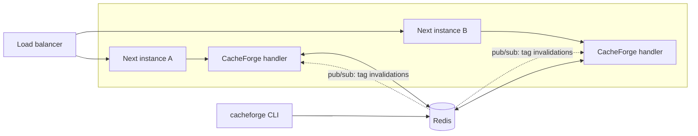

# 🗄️ CacheForge

> A shared cache for self-hosted Next.js. Every instance serves the same ISR pages, `fetch` data and `'use cache'` entries, and `revalidateTag` on one instance reaches all of them.


---

## 🎯 Purpose

Next.js keeps its caches (ISR pages, the `fetch` data cache, `'use cache'` results) in the memory and disk of **one process**. That is fine on Vercel, which provides the shared layer. On two containers behind a load balancer it breaks in a quiet way:

1. Instance A renders `/posts` and caches it. Instance B has its own copy, rendered at another time.
2. An editor publishes, and a webhook calls `revalidateTag('posts')`. The load balancer sends it to **A**.
3. A serves fresh content. **B keeps serving the old page** until its timer runs out. Reloading the page flips between versions.

Next.js lets you plug in your own cache handler, but the contract is subtle (soft tags, stale vs expired, a pending `set` that a `get` must wait for) and a naive Redis handler gets details wrong. CacheForge is that handler, written against Next 16's real behaviour and tested with two real `next start` processes.

### Where the problem comes from

| Source | What it says |
|---|---|
| [vercel/next.js#91824](https://github.com/vercel/next.js/discussions/91824) | *Horizontal scaling with a custom Redis `cacheHandler` on self-hosted Next.js: is this approach complete?* The thread covers instance A revalidating while instance B only sees a miss later. |
| [Next.js self-hosting guide](https://nextjs.org/docs/app/guides/self-hosting) | Documents that the default cache is per instance and points to `cacheHandler` for multi-instance setups. |
| [@neshca/cache-handler](https://github.com/caching-tools/next-shared-cache), [nextjs-turbo-redis-cache](https://github.com/trieb-work/nextjs-turbo-redis-cache) | Existing community handlers. CacheForge is not the first; see [How it differs](#how-it-differs). |

The e2e suite first reproduces the bug on Next's built-in cache, then shows it gone with CacheForge.

---

## ✨ Features

- **Both Next cache interfaces.** `createCacheHandler` for ISR pages, route handlers and `fetch`/`unstable_cache` (`cacheHandler`), and `createUseCacheHandler` for `'use cache'` and `'use cache: remote'` (`cacheHandlers`).
- **Cluster-wide `revalidateTag`.** Hard (`{ expire: 0 }`) and soft (`'max'`, stale-while-revalidate). Tag writes are monotonic in Redis (a Lua max-set), so concurrent invalidations never roll each other back.
- **Local reads, pushed invalidations.** Each process keeps a view of the tags, updated over Redis pub/sub within milliseconds, with a periodic full sync as a safety net. `consistency: 'strong'` asks Redis on every read instead.
- **Immune to clock skew.** Entries and invalidations are stamped with Redis time (plus a measured offset), not each host's `Date.now()`. A host whose clock is 30 s ahead cannot make an invalidation miss its pages.
- **An outage costs milliseconds, not requests.** Every cache call has a timeout and a circuit breaker. With Redis down, reads become misses and pages render from the origin. Invalidations still fail loudly, because hiding them would serve stale content silently.
- **Soft revalidation actually works.** Next re-checks tags in a process-global manifest that custom handlers never fill, so `revalidateTag(tag, 'max')` silently does nothing on ISR pages. CacheForge mirrors cluster invalidations into that manifest (see `next-bridge.ts`).
- **CLI.** `cacheforge stats | ls | tags | show | revalidate | rm | flush` against the same Redis.
- **Testable.** `createTestCluster` gives you N handler instances over one in-memory store, with optional clock skew, so you can test your own invalidation flows without Redis.

---

## 🏗 Architecture



| Package | Role |
|---|---|
| `@cacheforge/core` | Contracts and the rules: `CacheStore` interface, tag stale/expired semantics (mirroring Next's own manifest), the Buffer/Map value codec, an in-memory store. All pure. |
| `@cacheforge/redis` | `RedisStore` on ioredis: entries as TTL'd strings, tags in two hashes with monotonic writes, pub/sub events, server time. |
| `@cacheforge/next` | The two handlers, plus `CacheForgeRuntime` (store, cluster clock, tag view, timeout and breaker) and the Next manifest bridge. |
| `@cacheforge/cli` | Inspect and invalidate from a terminal. |

**How a read works.** `get` fetches the entry from Redis, checks its tags against the local tag view (`expired` after the entry was written means a miss, `stale` means serve and refresh), and decodes it. **How an invalidation works.** `revalidateTag` stamps the tags with cluster time, applies them locally (so the calling instance sees its own write at once), writes them to Redis and publishes them. Every other instance applies the event to its view and to Next's manifest.

---

## 🚀 Getting started

```bash
npm install
npm run build

# Redis for the examples and the tests
docker run -d --name cacheforge-redis -p 6390:6379 redis:7-alpine

npm test                  # 36 unit tests (the Redis ones need the container above)
npm run test:e2e          # 10 e2e tests: real `next start` processes (build the examples first)
```

### Use it in your app

```js
// next.config.mjs
export default {
  cacheHandler: new URL('./cache-handler.mjs', import.meta.url).pathname, // ISR, fetch, route handlers
  cacheMaxMemorySize: 0, // no per-process copy of the cache
  // Next 16 with cacheComponents: true, for 'use cache':
  // cacheHandlers: { default: new URL('./cache-handlers.mjs', import.meta.url).pathname },
}
```

```js
// cache-handler.mjs
import { createCacheHandler } from '@cacheforge/next'

export default createCacheHandler({
  store: process.env.REDIS_URL,
  prefix: process.env.GIT_SHA, // one prefix per deployment, see Production notes
})
```

```js
// cache-handlers.mjs (for 'use cache')
import { createUseCacheHandler } from '@cacheforge/next'

export default createUseCacheHandler({ store: process.env.REDIS_URL, prefix: process.env.GIT_SHA })
```

### Try the demo

```bash
GATEWAY_PORT=8090 docker compose up --build   # Redis + two Next instances + an nginx round-robin
curl -s localhost:8090/posts | grep -o 'id="generated-by">[^<]*'      # same answer however often you hit it
curl -X POST 'localhost:8090/api/revalidate?tag=posts&hard=true'      # lands on one instance
curl -s localhost:8090/posts | grep -o 'id="generation">[^<]*'        # both instances moved on
docker compose run --rm cli ls                                        # what is in the cache
```

`EXAMPLE=usecache-app docker compose up --build` runs the `'use cache'` example instead.

### Options

| Option | Default | Meaning |
|---|---|---|
| `store` | required | Redis URL, or any `CacheStore` |
| `prefix` | `cacheforge` | Key prefix |
| `consistency` | `'eventual'` | `'strong'` queries Redis for tags on every read |
| `syncIntervalMs` | `5000` | Safety-net full tag sync |
| `timeoutMs` | `750` | Per-operation timeout before falling back to the origin |
| `breaker` | `{ failures: 3, cooldownMs: 5000 }` | Skip the store after repeated failures |
| `onError` | one `console.warn` per 10 s | Called on every store failure |
| `syncNextManifest` | `true` | Mirror invalidations into Next's tag manifest |

---

## 🧭 Production notes

- **Use one `prefix` per deployment** (the git SHA works). Cached RSC payloads belong to the build that produced them; sharing them between two versions during a rolling deploy can serve markup that does not match the running JavaScript. Pair it with something like [SkewForge](../SkewForge) for the browser side.
- **`cacheMaxMemorySize: 0`.** A per-process copy would defeat the point.
- **`next build` instantiates the handler.** Builds work without Redis (calls time out and fall back), but a reachable Redis at build time will receive the prerendered entries.
- **Redis eviction.** Entries have TTLs (30 days by default, the `revalidate` time for `'use cache'`). Use `maxmemory-policy allkeys-lru` or `volatile-lru`. Evicting tag hashes would resurrect invalidated pages, so give tags their own Redis or an `noeviction` instance if you rely on hard expiry for a long time.
- **Same-millisecond writes.** As in Next itself, an invalidation only expires entries written strictly before it.
- **Internals.** The manifest bridge imports `next/dist/server/lib/incremental-cache/tags-manifest.external`, which is not public API. If it ever disappears the handlers fall back to enforcing hard expiry themselves, and the e2e test `why the Next manifest bridge exists` will tell you what you lost.

### How it differs

[@neshca/cache-handler](https://github.com/caching-tools/next-shared-cache) and [nextjs-turbo-redis-cache](https://github.com/trieb-work/nextjs-turbo-redis-cache) are established and have more storage backends than this project. What CacheForge adds, and what you should check before choosing: both Next interfaces in one package, store-time stamping against clock skew, an explicit timeout and breaker policy, the manifest bridge for soft revalidation, and e2e tests with negative controls (the same app on Next's default cache must show the bug).

---

## 🧪 Tests

- **Unit (36).** Tag semantics, codec, `MemoryStore`, both handlers over a simulated cluster (including skewed clocks, a dead store, the strong mode), and `RedisStore` against a real Redis.
- **e2e (10).** Two real `next start` processes per example against Redis: shared pages, hard and soft revalidation, `'use cache: remote'`, Redis cut mid-run and recovery (through a TCP proxy), Redis down at boot. Controls run the same apps on Next's built-in cache and assert the divergence, and one test runs without the manifest bridge to show soft revalidation never lands.

## 🗺 Roadmap

- [ ] Stores for Valkey Cluster / Sentinel and for DynamoDB or S3 (large entries)
- [ ] A small in-process L1 for entry bodies, invalidated by the pub/sub events
- [ ] Compression for large RSC payloads
- [ ] Metrics: hit/miss/degraded counters and an `onEvent` hook
- [ ] Dashboard for browsing entries and tags
- [ ] Publish to npm; CI with a Redis service container
- [ ] Verify against Next 15.x and the 16.x minor releases (tested on 16.3.8 only)

## 📄 License

MIT
